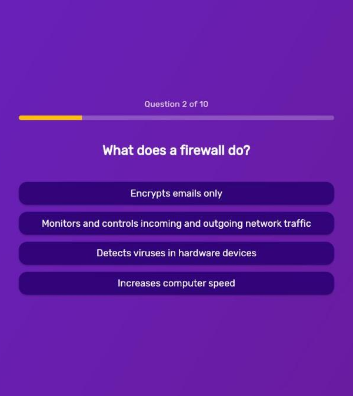
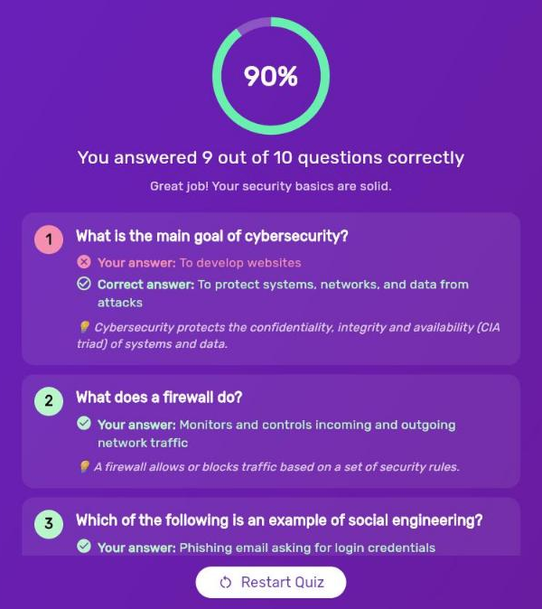

<div align="center">


# CyberQuiz 🛡️

**A Flutter quiz app that tests your cybersecurity fundamentals**, from firewalls and phishing to malware, VPNs and encryption.

[](https://github.com/RafayAijaz/Quiz-App/actions/workflows/ci.yml)


### [▶️ Try the live demo](https://rafayaijaz.github.io/Quiz-App/)


</div>

---

## 📸 Screenshots

| Start | Question | Results |
|:---:|:---:|:---:|
|  |  |  |

## ✨ Features

- **10 cybersecurity questions** covering the CIA triad, firewalls, social engineering, malware, VPNs, TLS, passwords, antivirus, phishing and DoS attacks
- **Progress bar** showing which question you're on
- **Shuffled answers**, so you can't memorise positions (shuffled once per question, so they never jump around mid-question)
- **Score ring and feedback** based on how well you did
- **Review screen** showing your answer, the correct answer, and a short 💡 explanation for each question
- **Smooth animated transitions** between screens
- **Responsive layout** that works on phones, tablets, web and desktop
- **Automated tests and CI**: every push runs `flutter analyze` and widget tests, then deploys the web demo to GitHub Pages

## 🏗️ How it works

```
lib/
├── main.dart                 # Entry point
├── quiz.dart                 # App shell: theme + screen state (enum-driven)
├── first_screen.dart         # Start screen
├── questions.dart            # Question screen with progress bar
├── answer_button.dart        # Reusable answer button
├── results_screen.dart       # Score ring + feedback
├── questions_summary.dart    # Per-question review cards
├── models/
│   └── quiz_question.dart    # QuizQuestion model
└── data/
    └── questions.dart        # Question bank with explanations
```

- **State management:** `StatefulWidget` + lifted state. The `Quiz` widget owns the selected answers and the current screen (`enum QuizScreen { start, questions, results }`).
- **Data model:** each `QuizQuestion` stores its text, answers (the first is correct) and an explanation. To add a question, add one entry to `lib/data/questions.dart`.
- **Styling:** Material 3 dark theme with the Rubik font via `google_fonts`.

## 🚀 Run it locally

```bash
git clone https://github.com/RafayAijaz/Quiz-App.git
cd Quiz-App
flutter pub get
flutter run            # pick a device: Android, iOS, Chrome, Windows...
```

## 🧪 Tests

```bash
flutter test
```

The widget tests play through the whole quiz (a perfect run and a run with one wrong answer) and check the score, the summary and the restart flow.

## 🗺️ Roadmap

- [ ] Instant right/wrong feedback after each answer
- [ ] Question categories and difficulty levels
- [ ] Timer mode
- [ ] Save high scores locally

## 👤 Author

**Rafay Aijaz**, Flutter developer and cybersecurity student
[LinkedIn](https://www.linkedin.com/in/muhammad-rafay-bb19b52b3) · [GitHub](https://github.com/RafayAijaz)
